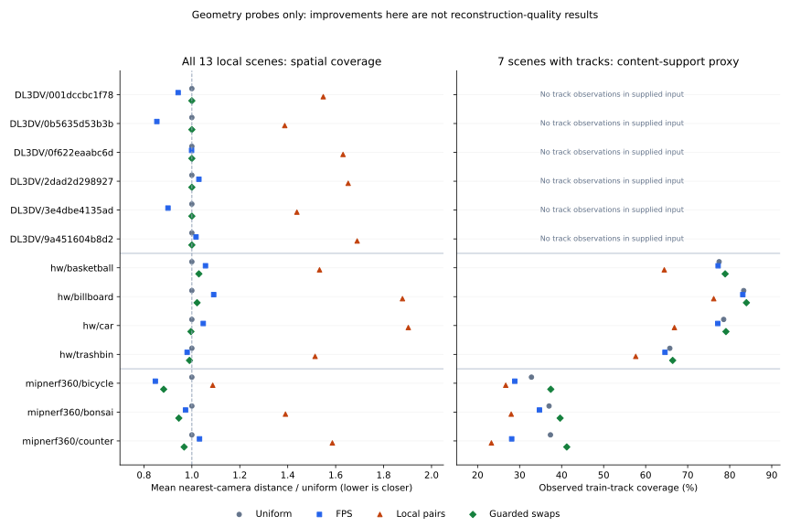

# rethink_v0：从实验结果追到机制

2026-10-30。被分析代码：`8aab3e0`；历史结果：[main_table](main_table.md)，历史决策：[plan_v0](plan_v0.md)。
本轮新增的是离线探针，不是新一轮完整 A/B 排名。复现入口：[probe/README](../probe/README.md)。

## 1. 先明确我们已经知道什么

最可靠的正向证据来自“让已有 ReSplat 初始化在短程内稳定收敛”：位置学习率日程对齐实际预算，
再取消周期性低透明度重置。反之，增加选帧规则、点数约束或损失项，并没有自动增加有效信息。
下一轮应首先检查覆盖是否互补、拓扑修改是否有恢复时间、优化器状态是否连续，以及计时和随机性是否可比。

下文区分三层：**实测事实**是代码、JSON、PLY 或探针直接支持的；**机制解释**是与事实一致但仍待隔离的因果假设；
**下一项验证**说明什么结果会支持或否定假设。单次小幅提升不称为稳定收益，未运行的模块不称为失败。

本机共有 13 个场景、3009 张可用且有位姿的图像，按 `llffhold=8` 为 2627 训练 / 382 留出。
已有可读取的完整评估记录为 44 个“配置×场景”条目，但只涉及 DL3DV `001dccbc…`、HW `billboard`、MipNeRF360 `counter`。
因此可以讨论三个数据集的几何特点，不能宣称已验证其他十个场景的重建质量。

| 数据集 | 本地场景数 | 图像数 | 全集探针 | 有训练轨迹的场景 | 已有完整 A/B 质量场景 |
|---|---:|---:|---|---:|---|
| DL3DV | 6 | 1995 | 全部 | 0（现有输入为 transforms） | `001dccbc…` |
| hw | 4 | 288 | 全部 | 4 | `billboard` |
| mipnerf360 | 3 | 726 | 全部 | 3 | `counter` |

## 2. 数据集全集：均匀采样为什么是强基线

定义：`d_U` 是未选训练相机到最近 context 中心的平均距离，除以训练相机包围盒对角线；
`L` 是按训练图像顺序累计路径长度，同样归一化；`θ95` 是相邻训练相机前向夹角的 p95。
`C/U` 是 coverage_local 的距离除以均匀距离，越大表示中心覆盖越差。
轨迹覆盖率为选中图像观测到的 point3D ID 并集占全部训练观测 ID 并集的比例，**不是可见表面积或真实遮挡覆盖**。
数据来自 [dataset_census.py](../probe/dataset_census.py)。DL3DV 用唯一短前缀标识目录。

| 数据集 / 场景 | 图像 / 训练 | 水平 FOV° | L | θ95° | d_U | C/U | 轨迹覆盖 U / FPS / local（%） |
|---|---:|---:|---:|---:|---:|---:|---|
| DL3DV / 001dccbc1f78 | 330 / 288 | 96.3 | 2.04 | 2.0 | .0307 | 1.55 | — |
| DL3DV / 0b5635d53b3b | 381 / 333 | 96.3 | 3.98 | 4.8 | .0522 | 1.39 | — |
| DL3DV / 0f622eaabc6d | 324 / 283 | 96.2 | 2.15 | 3.7 | .0312 | 1.63 | — |
| DL3DV / 2dad2d298927 | 305 / 266 | 96.3 | 2.49 | 2.7 | .0390 | 1.65 | — |
| DL3DV / 3e4dbe4135ad | 307 / 268 | 96.1 | 2.58 | 3.7 | .0402 | 1.44 | — |
| DL3DV / 9a451604b8d2 | 348 / 304 | 96.1 | 2.88 | 2.9 | .0464 | 1.69 | — |
| hw / basketball | 79 / 69 | 54.0 | 2.69 | 13.6 | .0493 | 1.53 | 77.48 / 77.24 / 64.43 |
| hw / billboard | 64 / 56 | 55.0 | 1.08 | 5.6 | .0220 | 1.88 | 83.33 / 83.11 / 76.20 |
| hw / car | 70 / 61 | 55.3 | 1.27 | 5.7 | .0256 | 1.90 | 78.56 / 77.16 / 66.85 |
| hw / trashbin | 75 / 65 | 54.9 | 2.58 | 13.8 | .0488 | 1.51 | 65.75 / 64.60 / 57.63 |
| mip / bicycle | 194 / 169 | 56.0 | 12.50 | 36.3 | .1033 | 1.09 | 32.82 / 28.85 / 26.70 |
| mip / bonsai | 292 / 255 | 51.6 | 5.83 | 6.7 | .0798 | 1.39 | 37.01 / 34.72 / 28.00 |
| mip / counter | 240 / 210 | 52.0 | 4.45 | 6.7 | .0615 | 1.59 | 37.34 / 28.12 / 23.29 |

**为什么按图像序号均匀选取可能有效？** 在本地 DL3DV 的宽视角、平滑轨迹中，顺序邻接大致也对应姿态邻接；
均匀分布16个观察位置会覆盖路径，而不是把配额花在已有位置附近。这里不是证明时间采样最优：
`bicycle` 的路径比值12.50、朝向变化p95达36.3°，图像序号就不能充分表征新内容。

**为什么 FPS 改善距离仍可能降低质量？** 它优化中心距离，不优化相机看向的表面。
例如 bicycle 的平均最近距离从 .1033 降至 .0875，但轨迹覆盖从32.82%降至28.85%。
空间分散与内容支持存在区别；也不能只换成朝向距离，因为同朝向仍可能拍到不同距离、遮挡后的内容。

**三个数据集的约束相同吗？** 相同16张配额下，HW 使用约23%–29%的训练池，Mip约6%–9%；
HW 的均匀轨迹覆盖为65.75%–83.33%，Mip仅32.82%–37.34%。这提示 Mip 更需要互补支持，
但数字也受 SfM 纹理、特征密度与轨迹长度分布影响，不能直接解释成同等比例的场景缺失。
DL3DV 缺轨迹不能填成0%覆盖；也没有必要先花昂贵的 SfM 成本把所有输入改成统一形式。

**覆盖是否还要看分布？** 要。平均覆盖会掩盖未支持的视角，至少同时记录未覆盖比例、
≥2视图支持、每训练视图支持p10、距离p95和最大序号间隙。所有选择只读取训练候选，
不使用留出图像的清晰度、轨迹或重建误差来选帧。已有源 SfM 没有重新用训练集建图，此限制也需记录。

## 3. A 的逐项机制审计

图中guarded swaps是下文的受约束两交换探针；DL3DV没有轨迹时回退uniform。

### uniform16 与 FPS

[uniform16](../baseline/utils_A/uniform16.py) 固定覆盖训练序列；[fps](../baseline/utils_A/fps.py) 逐次最大化最近中心距离。
FPS 相对原基线的 LPIPS Δ（DL3DV / HW / counter）为 −.0002 / −.0007 / +.0085。
前两项很小且未重复，counter明显变差。新探针中的 counter 轨迹覆盖37.34%→28.12%，视锥覆盖99.265%→96.720%，
与“空间分散没有覆盖对应内容”的解释一致。证据支持否决当前纯中心FPS作为通用替代，不支持否决所有几何选帧。

### coverage_local：把共视代理当成互补信息

[coverage_local.py](../baseline/utils_A/coverage_local.py#L23) 先选8个锚帧，再为每个锚帧分配一个姿态邻帧；
位置与朝向距离的固定权重为0.6/0.4。没有实际检查遮挡，也没有图像内容覆盖项。
LPIPS Δ 为 +.0095 / +.0063 / +.0037，DL3DV PSNR −.697 dB；三个场景均未得到预期收益。

固定 seed=0、20k 基线高斯中心的新诊断如下；点云来自既有 ReSplat，视锥内不等于可见。

| 场景 | ≥1视锥覆盖 U / local（%） | ≥2视锥覆盖 U / local（%） | 最近邻视锥 Jaccard U / local（%） | 相邻选帧训练序号间隙中位数 U / local |
|---|---|---|---|---|
| DL3DV | 99.450 / 99.245 | 97.745 / 99.180 | 89.52 / 99.46 | 19 / 1 |
| billboard | 99.595 / 99.325 | 98.085 / 97.240 | 89.32 / 90.97 | 4 / 1 |
| counter | 99.265 / 94.850 | 94.605 / 93.615 | 75.79 / 91.60 | 14 / 1 |

DL3DV 的两视图覆盖还提高了，但最大序号空档从20增至79，成对视锥几乎重复，质量反而下降。
因此“更多点被两张图看到”本身不是充分条件：三角测量基线、内容互补和全路径覆盖也重要。
全集上 local 在13/13场景增大平均最近距离，在7/7有轨迹场景降低轨迹覆盖，失败方向不只存在于 counter。

历史 counter 诊断的均匀覆盖为99.14%，新样本为99.265%；旧JSON未保存采样种子，不能将两次样本混写。
新探针另用四种A各5k点合成参考，counter覆盖仍为均匀98.585% > local96.345%。这缓解了单一参考点云偏差，
但混合点云仍不能证明遗漏的真实几何已被计入；HW极小覆盖差的次序会随参考点集变化。
这些点云只用于离线诊断，不能在A中无成本使用尚未执行的ReSplat输出。

### quality_filter 与 frequency audit：清晰度代理不等于真实模糊

[quality_filter.py](../baseline/utils_A/quality_filter.py#L21) 对256²灰度图计算Laplacian方差，
低于训练池中位数的0.8倍则找序号最近的合格帧替换。平滑墙面也可能低分，纹理丰富的模糊图仍可能高分。
实际替换5/0/3张；LPIPS Δ为+.0009/+.0001/−.0011，仅counter略有改善，A平均增加约2.63秒。

新取证发现 billboard 的 context 和输入ReSplat PLY哈希完全相同，却仍出现PSNR均值−.00209 dB、
LPIPS逐视图均值+.00004（表中舍入为+.0001）。这不能归因于选帧，只能提醒我们存在运行非确定性或其他未记录差异。
FFT离线筛选与Laplacian的替换重合为DL3DV5/5、counter2/3，尚不能提供独立质量证据，未跑完整FFT模块。
全集原图清晰度代理只用于描述分布，与历史两阶段resize的实际替换数分开记录。

全集还呈现以下图像统计差异。每格是“各场景训练图像中位数”的最小–最大范围，不是按图像数量加权的总体均值；
原图转灰度后直接缩至256²，灰度均值/标准差除以255，近端点比例指灰度<5或>250。

| 本地数据集 | Laplacian方差中位数范围 | 灰度均值中位数范围 | 灰度标准差中位数范围 | 近端点像素比例中位数范围 |
|---|---:|---:|---:|---:|
| DL3DV | 910–4574 | .440–.653 | .220–.272 | .19%–.40% |
| hw | 1189–3230 | .480–.557 | .278–.376 | 1.42%–22.44% |
| mipnerf360 | 1183–2684 | .247–.329 | .180–.207 | .93%–3.93% |

同一数据集内的清晰度代理跨度也很大；Mip整体灰度更低、HW部分场景近黑/白像素更多。
这些是输入特点，不能直接标为“模糊”“曝光错误”：黑背景、白墙或真实阴影也能产生相同统计。
它们支持按同图合成退化和局部邻域做质量代理校准，而不是跨数据集用绝对锐度/亮度阈值删帧。

### 定向探索：保留均匀骨架，有限交换能否补内容？

[covisibility_swaps.py](../probe/covisibility_swaps.py) 从uniform16出发，每个时间分区保留一帧，保护两端，
最多交换两张；目标为新增训练轨迹并集。平均最近距离不得超过均匀的1.1倍，每视图支持p10不得降低，
最大序号间隙不得超过均匀的2倍。参数跨场景固定，无轨迹则回退uniform。

| 场景 | 轨迹覆盖 U → 交换（%） | 每视图支持 p10 U → 交换（%） | 最近距离比 交换/U |
|---|---|---|---:|
| basketball | 77.48 → 78.92 | 78.93 → 81.28 | 1.029 |
| billboard | 83.33 → 83.97 | 88.84 → 89.24 | 1.022 |
| car | 78.56 → 79.10 | 77.54 → 78.24 | .996 |
| trashbin | 65.75 → 66.43 | 67.49 → 69.17 | .990 |
| bicycle | 32.82 → 37.42 | 14.58 → 20.07 | .882 |
| bonsai | 37.01 → 39.64 | 37.28 → 38.12 | .946 |
| counter | 37.34 → 41.22 | 31.48 → 35.92 | .968 |

这证明存在“少量交换、几何不明显变坏、轨迹支持改善”的可行选择，尤其Mip，不证明重建质量提升。
目标直接优化轨迹并集，覆盖改善是优化结果而非独立泛化证据；p10也参与约束。下一步必须通过ReSplat和B评估。
当前CPU探针有轨迹场景耗时约0.25–2.67秒，包含读取轨迹/位姿，不是接入A后的正式时间增量。
真实表面遮挡、纹理偏好、尺度差异和细长轨迹重复计数仍是未解决问题。

## 4. B 的逐项机制审计

### short_budget：有好的初始化，不代表可以直接截断长训练配方

[short_budget](../baseline/utils_B/short_budget.py) 只减少迭代，仍沿用位置LR的30000步衰减终点。
7000步相对基线在DL3DV/counter下降.778/.634 dB；更短预算在billboard测试也不支持直接截断。
3000步恰在周期性opacity reset后保存，PSNR仅5.598；跳过末步reset恢复22.597，却仍有LPIPS .1841。
这里两种问题必须分开：末步操作能破坏已学模型；修复末步也没有自动解决剩余优化不足。

### short_schedule：训练预算与收敛日程一致

[short_schedule](../baseline/utils_B/short_schedule.py) 固定7000步，仅把位置LR终点改为7000。
相对同预算short_budget，PSNR +.934 / −.023 / +.412 dB，LPIPS三组均改善，逐场景相对改善均值约8.00%。
这支持短程更早进入低LR精修的假设，不是“所有质量指标均改善”；已修正main_table的旧措辞。
5000步通过旧门槛；3000步counter相对基线PSNR−1.039、LPIPS+.0164，1000步DL3DV PSNR−.625。
说明预算下限受场景未拟合内容影响，不能由一个好跑的场景决定通用步数。

### no_reset：最强正向证据，但名称掩盖了另一层状态重置

[no_reset](../baseline/utils_B/no_reset.py) 关闭周期性将opacity压至.01的操作。
相对short_schedule7000，PSNR +.435 / +.077 / +.163 dB，LPIPS −.0071 / −.0063 / −.0068。
逐视图LPIPS变差数为2/42、0/8、0/30；78/80视图改善，输入PLY完全相同。
这种跨场景、逐视图较一致的效果比单场景小幅均值变化更有说服力，但仍是单次训练对照。
HW的PSNR平均改善而中位数−.00565、5/8视图下降，不能写成每个视图所有指标都更好。

为什么有用？ReSplat已经给出有意义的透明度，强制低opacity会扰动可用表面，短预算恢复不充分。
这是与结果一致的解释，仍需reset前后渲染/损失轨迹才能直接定位恢复成本。

更深一层：[密集化末尾](../baseline/fastgs/scene/gaussian_model.py#L527) 每次仍将opacity限幅到.8，
调用 [replace_tensor_to_optimizer](../baseline/fastgs/scene/gaussian_model.py#L327) 无条件清零该参数的Adam一、二阶矩。
CPU微探针中参数值完全未变，动量绝对值和却从.6000000变成0；最终PLY的opacity p90/max均为.8。
因此“无重置”仅指关闭周期性.01操作。该.8行为上游FastGS也存在，并非本地误写；
它是否适合ReSplat接续训练尚未验证。应单独比较“只对实际被限幅条目重置状态”，不同时改阈值与增密。

### regularized：末端剪枝没有恢复机会

[regularized](../baseline/utils_B/regularized.py) 本轮实际只做训练结束后的重要性剪枝，并没有测试全部正则化想法。
counter相对short_schedule7000：点数299985→273714（−8.76%），PSNR−.204、LPIPS+.0001，B+1.58秒。
在训练结束后做评分/删除不能节省已经花掉的训练时间；删除的影响也没有后续优化修复。
模型更小不等于训练更快。合理后续是把预算/剪枝放在中途并留恢复段，但不能称为已经证明有益。
曝光补偿、视锥尺度约束等未实测，不能随该模块一起判失败。

### topk_growth：点数预算没有约束主要计算成本

[topk_growth](../baseline/utils_B/topk_growth.py) 对符合原规则的生长候选做top-k，点数上限为输入489004。
counter累计71937候选选择62272，最终326008 vs no_reset的326892；两者最终几乎一样。
PSNR−.084、LPIPS+.0004，B70.43 vs68.14秒，越过10%时间档但远未触犯100%硬预算。
排序/取数仍有成本，原多视图评分仍执行；点数没有描述投影半径、tile覆盖和可见数。
且 [budgeted_growth_mask](../baseline/module_b/train_from_ply_fastgs.py#L75) 混合未归一化的普通梯度与绝对梯度排序。
因此只能否定这个预算定义和实现，不能推导“预算式生长无效”。下一步先看算力花在哪，再定义预算。

### coarse_to_fine：改分辨率同时改变了优化与生长的含义

[coarse_to_fine](../baseline/utils_B/coarse_to_fine.py) 前2800步半宽半高、后4200步全分辨率。
counter相对no_reset7000：PSNR−.163、LPIPS+.0043，B少4.50秒；阶段训练时间22.17/32.24秒。
内参/FOV已一致，但梯度阈值和像素半径阈值未随尺度校准，切换时重新建立相机抽样栈也改变后续采样序列。
低分辨率可能同时少拟合细节、改变增密触发与打分，无法只归因为“粗到细不好”。
先固定PLY和同一训练视图，测半/全尺度梯度及半径分布，再决定归一化；不要猜一个倍率立即重跑。
若端到端更快且质量在可接受范围，该方案仍可属于Pareto候选；v0停止的是当前固定配置的优先扩展。

### long_axis_split：一维位移与三维缩放不匹配

[分裂实现](../baseline/fastgs/scene/gaussian_model.py#L432) 只将子中心位移限制在最长轴，却仍把三个轴全部除以1.6。
横向没有中心位移补偿，对等权、同方向子高斯混合，横向方差变成原来的 `1/1.6²=0.390625`。
这只是参数化混合的解析结论，真实alpha合成不等同于概率混合；原随机分裂也不保证严格矩守恒。

新增PLY审计表明，三个输入PLY **全部高斯** 的最短轴都约为1e-6，匹配
[模型clamp_min_scale](../resplat/config/model/encoder/resplat.yaml#L11)，不是PLY导出的1e-9下限。
最长/最短轴比中位数分别约248194、60297、41595；中间/最长轴比中位数为.299/.355/.366。
我们接续的是强各向异性、近薄片的初始化，不是普通SfM点初始化的小球。
只沿一个切向轴分散，同时缩短另一切向轴，有损失面内覆盖的风险；不能从高轴比直接判断异常点应被删除。

完整结果：counter PSNR+.090、LPIPS−.0001，HW−.055/+.0007，DL3DV−2.030/+.0024。
DL3DV39/42视图PSNR下降，中位数−1.920 dB，最差−3.942，属于广泛退化而非单张异常。
PNG残差MSE均值从.0004764增至.0007669；16×16块均值残差能量占比从31.96%增至50.97%，
全局RGB均值偏差占比反从3.84%降至3.20%。它更像空间局部低频拟合问题，不支持仅靠全局曝光校正。
这还不能证明“出现空洞”：要用受控分裂前后render、alpha覆盖和矩诊断进一步验证。
分裂随机数消耗也改变，需固定标准随机样本作对照。下一轮先做算子探针，不直接换一个分裂公式全量训练。

### perceptual_loss：指标权重大不意味着简单加同名损失就有效

[perceptual_loss](../baseline/utils_B/perceptual_loss.py) 每16步在一个训练视图上计算256² VGG-LPIPS，权重.1，
7000步共437次；counter PSNR+.031、LPIPS+.0015，21/30留出视图LPIPS更差，B+2.91秒到10.19%预算。
训练图像强制方形缩放、低分辨率特征与正式评估不同，稀疏损失调用也未必覆盖最难内容。

此外微探针确认LPIPS构造改变torch CPU RNG；随后同分布100/1000无放回采样与无构造对照只重合9%。
实际 [剪枝](../baseline/fastgs/scene/gaussian_model.py#L517) 正是CPU上的torch.multinomial。
所以这项对照还混入了剪枝采样改变，不能把+.0015全归因于感知损失。9%是微探针样本重合率，不是实际训练点重合率。
先隔离RNG，再比较保长宽比的训练patch损失；同时记录损失梯度相对L1/SSIM的量级，不直接增加权重。

### pose_refine、sparse_optimizer 与尚未展开的项

| 项目 | 已验证事实 | 能得出的结论 / 下一门槛 |
|---|---|---|
| pose_refine | 当前FastGS渲染器把相机矩阵放在无梯度的raster_settings | 当前路径不可训练相机；未验证位姿优化质量。先确认跨视图残差指向位姿误差，再做相机梯度/坐标一致性验证 |
| sparse_optimizer | 本机扩展缺SparseGaussianAdam，现有optimizer_step也依赖SH优化器 | 接口前提未满足；不能写成速度失败。独立验证安装、状态迁移、密集化和标准PLY渲染 |
| exposure | 未跑；long-axis的退化不是以全局RGB偏差为主 | 不优先用曝光补偿解释当前主要退化；若新场景存在曝光漂移再用训练数据验证 |
| view-cone/Fisher等 | 未跑；有些方法需要已训练几何或可微相机 | 不能把B之后才能得到的信息当成免费A输入；先量化前置成本 |
| 0步 / 直接ReSplat渲染 | 未作为正式完整对照 | 可作为初始化诊断，不虚构性能、速度；仍需标准渲染一致性 |

## 5. 共同瓶颈：最后一次拓扑变化与计时盲区

[训练循环](../baseline/module_b/train_from_ply_fastgs.py#L209) 保留15000步增密截止，7000步运行会在600、700、…、7000步发生65次增密。
每次10个评分相机、每相机两次评分渲染，合计1300次额外前向调用；这是代码调用数，不是测得的耗时比例。
最后一次增密后 `iteration < iterations` 不成立，不再做优化器更新，之后直接保存。
末次拆分/剪枝和.8限幅都没有恢复时间；与末步.01 reset不同，这条路径在no_reset中仍存在。

因此最值得先问：停止末次拓扑变化是否直接减少保存时的误差？进一步保留20%的固定拓扑恢复期能否同时省评分时间并改善质量？
它们需要分别测试，不能与改损失、改点数、改分辨率一起打包。

训练纯计时用 `time.time()`，边界没有明确CUDA同步；循环中的`.item()`等会发生同步，但不能保证边界语义完整。
现有`cfg_args`也主要记录dataset字段。需要完整参数、随机状态、相机序列、阶段CUDA事件/墙钟和点数轨迹。
为了可比，诊断插桩与正式计时应分开；高频同步本身会拖慢训练。

## 6. 以现有指标约束方向

当前7000步质量优先候选 `uniform16 + no_reset` 的三场景平均为27.940 / .8837 / .1631，B60.22秒、总137.42秒；
5000步为27.729 / .8801 / .1674，B47.76秒、总125.24秒。两者是不同取舍，不应压成一个未经定义的“综合分”。
相对原基线，7000步LPIPS逐场景相对改善的等权均值6.05%，B缩短19.97%；这些是不同物理量，不直接相乘当比赛分。

依本仓库[工作流](agent_workflow.md)，权重PSNR/SSIM/LPIPS/时间=20/20/40/20，B严格低于经典30k预算，≤10%为时间满分档；
本地没有完整官方归一化/档外评分曲线，不能凭这些权重计算官方综合得分。根README还有端到端快于经典管线的目标，需继续独立报告端到端口径。
counter的7000步B为68.14秒，10%阈值69.707秒，仅余1.567秒；要验证时间分布而不是凭单次9.78%宣布稳定满档。

A均值约46.67秒、ReSplat约30.53秒，两者合计已约77.20秒。即使B趋近0，当前冷运行也不能到半分钟；
要分解A图像读写/resize成本，并区分原始数据准备、冷缓存与热缓存，不能把缓存移出计时冒充算法提速。
下一轮具体门槛与参考实现见 [plan_v1_draft](plan_v1_draft.md) 和 [plan_v1](plan_v1.md)。
